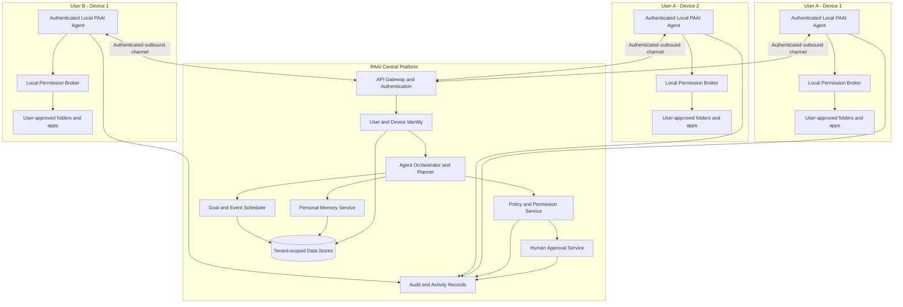

# PAAI Architecture

## Product direction

PAAI is a multi-user, multi-device personal autonomous-agent platform. Each person has one authenticated account and an isolated personal agent context. A person can connect multiple computers, and each computer can have different local permissions. A computer may also be shared by multiple people, with separate operating-system sessions and separate PAAI identities.

PAAI's long-term capability is to understand and assist with a user's computer and approved digital environment. "Full PC access" describes the range of capabilities the platform may support; it does not mean unrestricted access. The user explicitly selects which folders, files, applications, activity sources, and actions are available. Access is denied by default, granted at the narrowest practical scope, auditable, and revocable.

This document distinguishes the **target architecture** from the **currently implemented foundation**. The local PC agent, device pairing, device command channel, and device-level permission UI are architectural targets, not claims about existing functionality.

## Product principles

1. **Person-first identity:** User accounts represent people; devices are separately registered resources.
2. **Multiple devices per user:** One user may connect multiple PCs and manage each independently.
3. **Shared-device isolation:** Multiple OS users on one PC must authenticate independently; no device-wide assumption grants one person access to another person's profile or files.
4. **Consent and least privilege:** Every local data source and action is denied until the user grants a specific permission.
5. **Local enforcement:** The PC agent enforces local access grants. A model, API request, or central service cannot bypass the local policy broker.
6. **Personal memory isolation:** Memory, goals, credentials, approvals, device data, and audit records are scoped to the authenticated user, with device provenance where relevant.
7. **Data minimization:** Prefer processing files locally and sending only approved, necessary extracted context to the central platform. Do not silently upload entire folders or continuous activity streams.
8. **Human control:** Users can inspect, correct, export, pause, and delete personal memory; disconnect devices; and revoke permissions.
9. **Auditable autonomy:** Local and external actions are policy-checked and recorded. Sensitive or high-impact actions require a separate approval step.
10. **Honest capability boundaries:** The system must not claim it has inspected, changed, or executed something unless the relevant device agent confirms the result.

## Target high-level architecture

The diagram shows the intended logical design. It does not imply that device agents or a production device gateway have already been implemented.

## Core layers

### 1. User identity and account security

- Users register and authenticate as individual people.
- All service operations derive the user ID from verified authentication context, never from LLM output or an untrusted request-body field.
- A user can register multiple devices.
- A device has its own stable device ID, owner relationship, registration status, public-key identity, last-seen time, and revocation status.
- Device pairing requires an authenticated user action and a one-time, expiring pairing challenge.
- Device credentials are unique per device, revocable, and never shared between devices.
- Shared computers require separate OS-user sessions and separate PAAI sign-in/pairing. A device ID alone is not proof of the active human identity.

### 2. Local PC agent

A lightweight local agent is planned for each connected computer. It is the only component permitted to access local resources on behalf of PAAI.

Planned responsibilities:

- Securely pair and authenticate the device.
- Maintain an authenticated outbound connection to PAAI; do not expose an unauthenticated inbound remote-control port.
- Discover available capability categories without reading private content.
- Present permission requests to the local user.
- Enforce per-user, per-device, per-resource, and per-action grants.
- Read or search only approved folders and files.
- Access only explicitly approved application integrations and activity sources.
- Execute only allowlisted local operations within the granted scope.
- Return bounded results and execution receipts to the central platform.
- Support pause, disconnect, credential rotation, and remote revocation.
- Apply resource limits and report errors without leaking secrets.

The local agent must not execute arbitrary shell commands merely because a model requested them. Any future command execution must use a constrained capability interface, validated arguments, policy checks, and explicit user authorization appropriate to the action's risk.

### 3. Device registry and secure communication

The central platform will maintain device records linked to user accounts. Device communication will use authenticated outbound sessions (for example, a mutually authenticated HTTPS/WebSocket channel) and a server-side command queue.

Every command must include or be associated with:

- Authenticated user and registered device identity.
- A unique command ID and idempotency key.
- Requested capability and resource scope.
- Permission-policy decision and policy version.
- Expiration/deadline and bounded execution limits.
- Approval reference when required.

The local agent re-checks the current local grant before execution. Revoked, expired, replayed, or incorrectly scoped commands are rejected. Device reconnects must not replay completed non-idempotent actions.

### 4. Permission and consent model

Permissions are layered, not a single "full access" switch:

| Permission category | Examples | Default |
|---|---|---|
| File discovery | List explicitly selected folders | Denied |
| File reading | Read selected files or folder trees | Denied |
| File writing | Create or edit files in selected locations | Denied |
| File deletion | Delete selected files | Denied; separate high-risk grant |
| Application access | Use a named application or supported integration | Denied |
| Activity/context | Observe selected app/window metadata or activity source | Denied; opt-in |
| Local execution | Run a specific supported local capability | Denied |
| External communication | Send email, publish, submit forms | Separate permission and approval |
| Financial/destructive actions | Purchase, pay, transfer, bulk delete | Denied; strong confirmation |

Grants should be scoped by user, device, capability, resource/path, operation, and (where appropriate) time. Avoid broad filesystem or administrator privileges. Sensitive actions require a fresh confirmation bound to the exact action and parameters; a general permission to read a folder must never imply permission to delete or transmit its contents.

### 5. Personal memory and context

Each user has an isolated memory namespace. Device observations retain source provenance and are not automatically treated as verified facts.

Memory categories:

- User-provided profile, instructions, and preferences.
- User-approved facts extracted from selected documents.
- Goals, routines, schedules, and task context.
- Completed actions and verified outcomes.
- Device-specific context and source references.
- User corrections and explicit memory controls.

Memory ingestion pipeline:

1. Check user identity, device identity, and active consent.
2. Check the requested resource against the current permission grant.
3. Read only the approved scope through the local agent.
4. Minimize and redact data where appropriate.
5. Send only the approved information needed for the requested purpose.
6. Store it in the correct user's memory namespace with source, device, timestamp, and consent provenance.
7. Allow the user to inspect, correct, expire, or delete the memory.

Do not continuously capture screens, keystrokes, clipboard contents, or all filesystem changes by default. Any such feature would require a distinct, visible, opt-in permission and a clear retention policy.

### 6. Agent orchestration and autonomy

The central orchestrator plans and coordinates tasks using the user's goals, memory, current permissions, and connected-device capabilities. It does not receive unrestricted operating-system access.

Execution flow:

1. Authenticate the user and identify the intended registered device(s).
2. Resolve the goal and relevant personal memory.
3. Ask the capability registry which approved capabilities are available on those devices.
4. Build a bounded plan using only those capabilities.
5. Check permissions and risk deterministically outside the LLM.
6. Request user approval for sensitive actions.
7. Dispatch a scoped command to the selected local agent or external integration.
8. Verify the device's execution receipt and persist the outcome.
9. Update relevant memory only with evidence-backed results.

A device being offline, permission being revoked, or an execution receipt being missing must result in a clear pending/failed state, not a fabricated success.

### 7. Events, goals, and workflows

- Goals remain owned by users and can be associated with one or more eligible devices.
- Device events are authenticated, size-limited, typed, deduplicated, and tenant-scoped.
- Event subscriptions must declare the event type and permitted source/device scope.
- Event dispatch and goal claiming must be durable and idempotent.
- Workflows and approvals must eventually persist across process restarts.
- Approval must be bound to the exact user, workflow/run, device, capability, and action parameters.
- A model cannot approve its own proposed action.
- Device-originated events cannot grant permissions or change identity.

### 8. Human approvals and audit

Maintain an append-only audit trail for device pairing, permission grants/revocations, data access, memory ingestion, command dispatch, approval, rejection, execution result, and device disconnection.

Approval is a distinct control from permission:
- Permission defines what a capability may do in general.
- Approval authorizes a particular sensitive action with exact parameters.
- The local agent performs a final policy check immediately before execution.

### 9. Data stores and deployment evolution

Current implementation is a single-host SQLite foundation. The target multi-device platform will require stronger shared infrastructure as it scales.

| Store/service | Current foundation | Target direction |
|---|---|---|
| User authentication | SQLite and signed bearer tokens | Hardened identity service, token rotation/revocation |
| Device registry | Not implemented | Persistent device registry and device credential lifecycle |
| Device communication | Not implemented | Authenticated outbound gateway and durable command queue |
| Profiles and memory | SQLite-backed user-scoped services | Tenant-isolated memory with source provenance and retention controls |
| Goals and events | SQLite-backed autonomy foundation | Durable distributed scheduler/queue |
| Permissions | Existing Phase 5 in-memory manager | Persistent user/device/resource/action grants |
| Workflows and approvals | Existing process-local Phase 5 managers | Durable exact-action approval and workflow state |
| Credentials | SQLite with Fernet encryption | Managed key lifecycle and secret management |
| Audit | Existing process-local Phase 5 logger | Durable append-only audit storage |
| API and worker | FastAPI and separate worker process | Horizontally scalable services with shared persistence |

For a multi-instance deployment, migrate from SQLite to PostgreSQL (or another appropriately transactional shared database), use a durable message broker/queue for device commands and events, implement distributed leases, and add managed secrets, TLS, monitoring, backups, and tested recovery.

## Trust boundaries and security requirements

1. Clients and devices are untrusted until their credentials and registration status are verified.
2. LLM output is untrusted data. It cannot select another user, device, path, permission, or approval outcome.
3. The central service cannot bypass the local permission broker.
4. Local resource access is checked on the device at execution time, not only when a plan is created.
5. Device credentials are unique, revocable, and stored securely.
6. Commands are scoped, expiring, replay-resistant, and idempotent where possible.
7. Secrets and raw credentials never enter model prompts or logs.
8. User data is isolated across accounts and device sessions.
9. Revocation and disconnection must stop future access; queued commands must be revalidated before execution.
10. Data collection and retention must be visible and controlled by the user.

## Current implementation versus target

Already present in the repository:
- Multi-user authentication and request identity scope.
- Tenant-scoped memory facade and user-owned services.
- Goal/run persistence and event ingestion foundations.
- Worker iteration over authenticated principals.
- Phase 5 integration permissions and approval concepts.
- Encrypted per-user Google credential storage.
- FastAPI API, deployment packaging, and test foundation.

Not yet implemented:
- Local PC agent and installer.
- Device registration, pairing, and revocation.
- Multi-device registry and per-device identity.
- Secure device command channel and durable command queue.
- Local permission broker and user-facing folder/application selection.
- Local file indexing/search and approved context ingestion.
- Device-aware memory provenance and user controls.
- Persistent permission grants and durable approvals/workflows.
- End-to-end device command execution and verification.

Do not describe PAAI as having PC access or multi-device support until these capabilities have been implemented, tested, and demonstrated end to end.

## Deployment model and limitations

The current repository remains a single-host SQLite foundation. It is not horizontally scalable and does not yet provide local PC access. The target device architecture must be implemented in controlled stages and security-reviewed before real user computers or private data are connected.

The repository does not claim production readiness until local tests and CI are green, device pairing and revocation are tested, tenant isolation is verified across users and devices, security/load testing is performed, backups are restored successfully, TLS and monitoring are configured, and a live deployment is verified.
