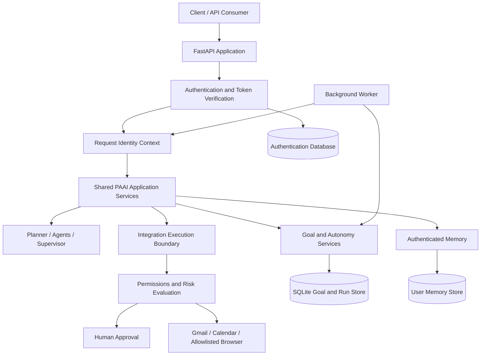

# PAAI Architecture

## Product direction

PAAI is one reusable autonomous-agent infrastructure shared by multiple authenticated users. A user request is authenticated by the application, converted into a trusted identity context, and passed through shared services. User-owned data and permissions remain tenant-scoped.

## High-level architecture

## Core layers

### Authentication and identity
- Email/password account registration and login.
- PBKDF2 password hashing.
- Signed, expiring HS256 access tokens.
- Authentication verifies the token and confirms the account still exists.
- FastAPI dependency establishes `identity_scope` from the verified token.
- Services derive tenant IDs from `current_identity()`; never from LLM output or request-body user IDs.

### Agent and orchestration
- The existing planner and planned agent handle bounded task plans.
- Specialized agents and supervisor provide multi-agent delegation.
- Memory manager and personalized agent provide approved long-term personalization.
- The Phase 5 integration workflow agent validates model-generated integration plans against registered connector actions.

### Permissions and external execution
- User permissions are separate from automatic-execution permissions.
- Risk classification is deterministic application logic.
- High-risk operations require human approval.
- Approval is bound to the exact action and parameters.
- Credentials must never enter model prompts.
- Browser automation requires an explicit HTTPS allowlist.

### Advanced autonomy
- Goals and runs persist in SQLite.
- Goal operations derive ownership from authenticated identity.
- One-time and fixed-interval schedules are supported.
- Scheduler atomically claims due goals.
- Default executor performs reasoning only; external action execution requires a trusted injected executor that applies Phase 5 security controls.
- Worker iterates authenticated principals and establishes a separate identity scope for each tenant.

### HTTP and operations
- FastAPI exposes authentication and goal lifecycle routes.
- Health endpoints support basic liveness/readiness checks.
- Request controls provide request IDs, response security headers, Content-Length bounds, and process-local rate limiting.
- Docker Compose runs API and worker as separate processes sharing a persistent local data volume.
- GitHub Actions installs dependencies, compiles Python modules, and runs the unittest suite.

## Data stores

| Store | Current implementation | Important boundary |
|---|---|---|
| Authentication | SQLite | Single-host; no refresh/revocation |
| Profiles | SQLite | User-scoped service |
| Long-term memory | Existing Phase 3 SQLite store + authenticated facade | Low-level functions still accept user IDs internally |
| Goals and runs | SQLite | Tenant-scoped; single-host scheduler |
| Credentials | SQLite credential store with Fernet encryption | Encryption key must be backed up separately; OAuth pending state is process-local |
| Permissions | SQLite manager | Per-user action grants persist; automatic grants are distinct from ordinary grants |
| Workflows | SQLite workflow state | Interrupted in-flight external actions become `execution_uncertain`; no automatic replay |
| Approvals | SQLite approval store | Owner-scoped, expiring, exact-action fingerprint, single-use consumption |
| Autonomy approval links | SQLite link table | Associates a workflow with its originating goal/run and reconciles interrupted writes |
| Audit | In-memory logger | Audit history is not yet durable across process restart |

## Trust boundaries

1. External clients are untrusted until a bearer token is verified.
2. LLM output is untrusted data. It cannot select a tenant, alter permission state, or bypass risk checks.
3. Connector parameters are validated against registered actions and passed through permission/risk/approval checks.
4. Background jobs re-establish a trusted identity from the authentication database before executing tenant-owned work.
5. Secrets are supplied through environment/managed secret configuration, not source code or prompts.

## Deployment model and limitations

The committed deployment foundation is a single-host SQLite setup. It is not horizontally scalable. A multi-instance deployment requires PostgreSQL, distributed job leases/queue, distributed rate limiting, and operational secret management. Audit records remain in-memory and need durable storage before relying on them for compliance or long-term incident investigation.

The repository does not claim production readiness until local tests and CI are green, security/load testing is performed, backups are restored successfully, TLS ingress and monitoring are configured, and a live deployment is verified.
